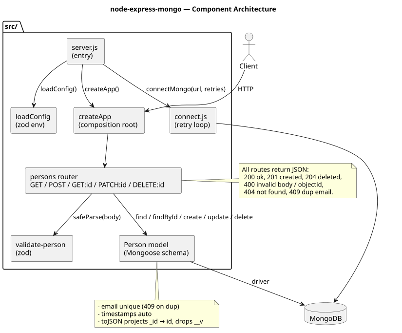
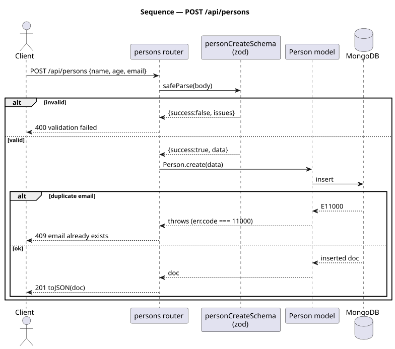
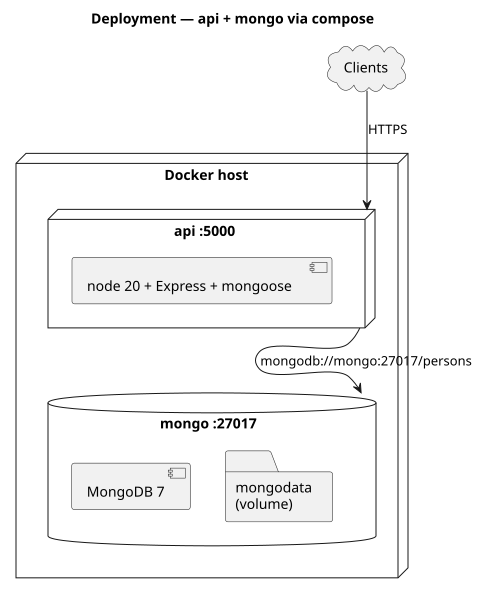

# node-express-mongo · Person REST API

Express + Mongoose CRUD for a `Person` resource (name / age / email).

[](https://github.com/tzone85/node-express-mongo/actions/workflows/ci.yml)


The repo name promised Mongo but the original code never integrated it —
just two hardcoded-string GET endpoints. This rewrite delivers the actual
product: full CRUD, validation, Docker, tests, CI.

## Bugs / smells fixed during the port

| File / area (original)            | Issue                                                                                          |
|-----------------------------------|------------------------------------------------------------------------------------------------|
| `package.json`                    | `mongoose` was never installed despite the repo name. Now first-class dependency.              |
| `src/routes/person.js`            | Two hardcoded-string GET endpoints; no DB. Replaced with full CRUD.                            |
| `src/routes/person.js:25-27`      | `GET /person/error` declared **after** `GET /person/:name` — Express matches `:name = "error"` first, so the throw is unreachable. Removed.       |
| Route paths under `/person`       | Inconsistent with REST conventions. Moved to `/api/persons` (plural, namespaced).              |
| No input validation               | Added zod schemas for create + partial update.                                                 |
| No error contract                 | All responses now JSON: 200/201/204 success; 400 validation/objectid; 404 not-found; 409 dup email; 500 internal. |
| Bare `app.use(express.static('public'))` | The HTML was a static greeting unrelated to the API. Dropped — API responds JSON only. |

## Architecture







Diagrams are PlantUML under `docs/architecture/*.puml`; rendered SVGs are checked in. Regenerate with `./scripts/render_diagrams.sh`.

## API

| Method | Path                       | Body / response                                                        |
|--------|----------------------------|------------------------------------------------------------------------|
| GET    | `/`                        | Service banner                                                         |
| GET    | `/health`                  | `{"status": "ok"}`                                                     |
| GET    | `/api/persons?limit=&offset=` | `{items, total, limit, offset}` — limit clamped to `[1,200]`        |
| POST   | `/api/persons`             | `{name, age, email}` → 201 with `{id, name, age, email, createdAt, updatedAt}` |
| GET    | `/api/persons/:id`         | 200 with the person, 404 if missing                                    |
| PATCH  | `/api/persons/:id`         | Partial body → updated person                                          |
| DELETE | `/api/persons/:id`         | 204 No Content                                                         |

`email` is unique; duplicate insert/update returns **409 email already exists**.

## Configuration

| Variable    | Required | Default                                  | Notes                                |
|-------------|----------|------------------------------------------|--------------------------------------|
| `MONGO_URL` | no       | `mongodb://localhost:27017/persons`      | Required to be a valid Mongo URL     |
| `PORT`      | no       | `5000`                                   |                                      |
| `LOG_LEVEL` | no       | `info`                                   | `debug`/`info`/`warn`/`error`        |

## Local dev

```
cp .env.example .env
npm install
npm test              # vitest + in-memory Mongo (mongodb-memory-server)
npm run lint
```

Run the full stack:

```
docker compose up --build
```

Compose brings up `mongo:7` with a healthcheck and waits for it before
starting the api container.

## Project layout

```
src/
├── server.js                  # entrypoint (loads .env, connects to mongo)
├── app.js                     # composition root — createApp({ PersonModel? })
├── config.js                  # zod-validated env
├── db/
│   └── connect.js             # mongoose.connect with retry loop
├── models/
│   └── person.js              # Mongoose schema + toJSON projection
├── services/
│   └── validate-person.js     # zod schemas for create + partial update
├── routes/
│   └── persons.js             # CRUD router
└── middleware/
    └── validate-object-id.js  # 400 on malformed :id before mongoose throws
tests/
├── unit/validate-person.test.js     # 8 schema tests
└── integration/persons-routes.test.js  # 15 supertest CRUD tests vs in-memory Mongo
docs/architecture/             # PlantUML + SVGs
.github/workflows/ci.yml
Dockerfile
docker-compose.yml
```

## Tests

| Suite                                       | Count   | What                                                                  |
|---------------------------------------------|---------|-----------------------------------------------------------------------|
| `tests/unit/validate-person.test.js`        | 8       | Valid/invalid create + partial update, lowercased+trimmed email       |
| `tests/integration/persons-routes.test.js`  | 15      | Full CRUD against `mongodb-memory-server`: 201 create + 409 dup-email + 400 bad body + GET pagination + 404 + 400 invalid id + PATCH + DELETE |
| **Total**                                   | **23**  | 85% line / 80% branch gate                                            |

## CI

Lint → tests (in-memory Mongo) → Docker build → `npm audit --audit-level=high --omit=dev`. `master` branch-protected requiring all 4 checks.

## License

MIT — see [LICENSE](LICENSE).
